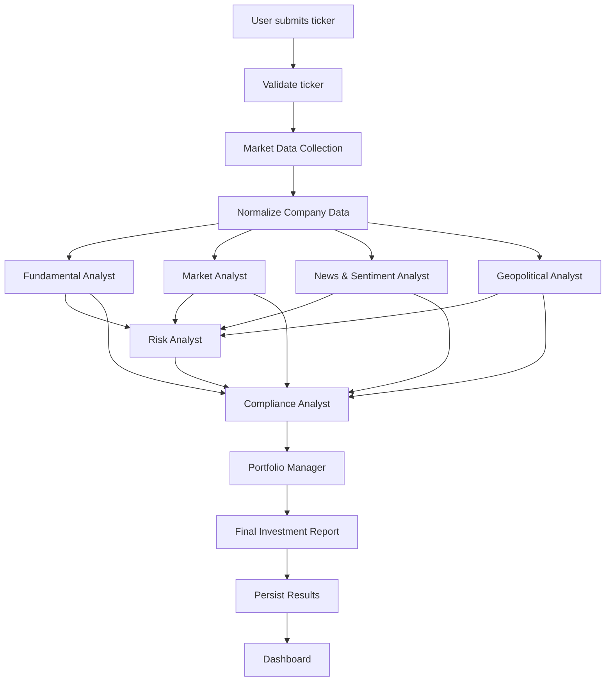

# PRD — Toth Research
**AI-Powered Multi-Agent Financial Analysis & Investment Research**

**Status:** Draft  
**Version:** 0.2  
**Product:** Toth Research  
**Product type:** Invite-only AI investment research platform  
**Target markets:** Brazilian (B3) and US stock markets  
**Primary LLM provider:** OpenRouter

---

# 1. Product Overview

## 1.1 Vision

Toth Research is an AI-powered financial research platform that uses a team of specialized AI agents to analyze publicly traded companies and produce comprehensive, structured investment research reports.

Instead of relying on a single LLM to analyze a company, Toth Research orchestrates multiple specialized agents, each responsible for a particular aspect of financial analysis.

The agents collaborate to evaluate a company's fundamentals, market performance, news, geopolitical environment, risks, and investment outlook.

The final result is a consolidated investment research report that helps users understand a company's financial health, market position, geopolitical exposure, risks, and potential investment attractiveness.

## 1.2 MVP Objective

Allow invited users to:

1. Access the Toth Research landing page.
2. Log in to a private dashboard.
3. Submit a stock ticker from either the Brazilian or US stock market.
4. Execute a predefined multi-agent analysis.
5. Monitor agent execution progress.
6. Explore individual agent findings.
7. Read and review the final consolidated investment report.
8. Access previously generated analyses.

## 1.3 Target Audience

- Individual investors interested in fundamental analysis.
- Technology professionals interested in AI-powered investment research.
- Financial analysts who want to accelerate their research workflows.
- Early adopters interested in multi-agent AI applications.

## 1.4 Product Principles

- **Transparency:** Every conclusion should be traceable to its underlying data or source.
- **Specialization:** Each agent has a clearly defined responsibility.
- **Collaboration:** Agents contribute to a shared research objective.
- **Reliability:** Financial facts must come from external data sources, not LLM assumptions.
- **Explainability:** Users should understand how the system reached its conclusions.
- **Global awareness:** Investment research must consider geopolitical events and their potential economic consequences.

---

# 2. MVP Scope

## 2.1 Included Features

| Feature | Description |
|---|---|
| Landing page | Toth Research public marketing page |
| Invite-only authentication | Access restricted to invited users |
| Dashboard | Main application interface |
| Stock search | Accept Brazilian and US stock tickers |
| Multi-agent orchestration | Execute all seven predefined agents |
| Execution monitoring | Show agent status and progress |
| Agent reports | Display individual agent findings |
| Final investment report | Consolidated analysis |
| Analysis history | Access previously generated analyses |
| PostgreSQL persistence | Store users, invitations, analyses and results |

## 2.2 Out of Scope

- Portfolio management.
- Brokerage integrations.
- Buying or selling stocks.
- Automated trading.
- Personalized investment recommendations.
- Real-time stock monitoring.
- Stock price alerts.
- Multiple ticker comparisons.
- User-configurable agents.
- Custom agent creation.
- Chat with agents.
- Subscription management or payments.
- Mobile applications.

The MVP focuses exclusively on analyzing one company at a time.

---

# 3. User Experience

## 3.1 Landing Page

The landing page should communicate the value proposition of Toth Research and provide access to invited users.

**Visual reference:** https://decade.com/

### Design direction

Use Decade's visual language as inspiration:

- Premium financial technology aesthetic.
- Minimalist and sophisticated interface.
- Strong typographic hierarchy.
- Generous whitespace.
- Restrained color palette.
- Editorial-style sections.
- Prominent financial metrics and numbers.
- Subtle transitions and animations.

Avoid making the product look like a generic AI chatbot or traditional stock trading terminal.

### Suggested sections

**Hero section**
- Toth Research branding.
- Main headline explaining AI-powered investment research.
- Short supporting description.
- Login button.
- Invitation-only messaging.

**How it works**
- Submit a stock ticker.
- Specialized agents investigate the company.
- Research findings are consolidated into an investment report.

**Agent team**
Introduce the seven specialized agents and their responsibilities.

**Example analysis**
Show a preview of a generated investment report.

**Footer**
- Product information.
- Disclaimer.
- Login link.

## 3.2 Authentication

The platform must be accessible exclusively through invitations.

### Requirements

- Users cannot publicly register.
- An administrator can create invitations.
- Invitations should be associated with an email address.
- Invitation links should have an expiration date.
- Invitations can only be redeemed once.
- Invited users can create their accounts.
- Users can log in and log out.
- Passwords must be securely hashed.

For the MVP, an administrator can create invitations through a simple protected administrative endpoint or database operation.

## 3.3 Dashboard

The dashboard is the primary application interface.

### Main components

**Header**
- Toth Research logo.
- Navigation.
- User profile.
- Logout.

**Main dashboard**
- Welcome message.
- New analysis button.
- Stock ticker input.
- Recent analyses.

**Analysis history**

Each entry should display:
- Company name.
- Stock ticker.
- Market.
- Analysis date.
- Execution status.
- Link to the analysis report.

## 3.4 New Analysis

The user should be able to initiate an analysis by submitting a stock ticker.

Examples:

- `AAPL` — Apple (NASDAQ).
- `MSFT` — Microsoft (NASDAQ).
- `PETR4` — Petrobras (B3).
- `VALE3` — Vale (B3).

### Flow

1. User enters a ticker.
2. Backend validates the ticker and identifies its market.
3. Backend retrieves the company's basic information.
4. User confirms the company.
5. User starts the analysis.
6. The multi-agent workflow begins.
7. Dashboard displays execution progress.
8. Once all agents finish, the final report becomes available.

A ticker must be validated before consuming LLM tokens.

## 3.5 Analysis Dashboard

### Overview

Display:
- Company name.
- Stock ticker.
- Exchange.
- Current stock price (if available).
- Analysis execution date.
- Overall execution status.

### Agent execution panel

Show each agent with its current status:

- Pending.
- Running.
- Completed.
- Failed.

Users should be able to expand an agent to inspect its findings.

### Final report

The consolidated report should include:

1. Executive summary.
2. Company overview.
3. Fundamental analysis.
4. Market analysis.
5. News and sentiment analysis.
6. Geopolitical analysis.
7. Risk assessment.
8. Investment thesis.
9. Bull and bear scenarios.
10. Overall assessment.
11. Sources and references.

---

# 4. Multi-Agent Architecture

## 4.1 Agent Team

The MVP will implement seven specialized agents.

### Agent 1 — Fundamental Analyst

**Objective:** Evaluate the company's financial health and business fundamentals.

Responsibilities:
- Analyze revenue growth.
- Analyze profitability.
- Evaluate operating margins.
- Analyze debt and liquidity.
- Evaluate cash flow.
- Analyze relevant financial ratios.
- Identify positive and negative fundamental indicators.

Expected output:
- Financial health assessment.
- Key financial metrics.
- Fundamental strengths.
- Fundamental weaknesses.
- Supporting evidence.

### Agent 2 — Market Analyst

**Objective:** Evaluate the company's stock market performance.

Responsibilities:
- Analyze historical price performance.
- Evaluate price trends.
- Identify volatility.
- Analyze trading volume.
- Compare relevant performance periods.
- Identify relevant market indicators.

Expected output:
- Market performance summary.
- Price trend assessment.
- Relevant market indicators.
- Positive and negative market signals.

### Agent 3 — News & Sentiment Analyst

**Objective:** Understand how recent events and market sentiment affect the company.

Responsibilities:
- Retrieve recent company-related news.
- Identify relevant industry developments.
- Analyze earnings announcements.
- Identify regulatory developments.
- Evaluate positive and negative sentiment.
- Identify potential catalysts.

Expected output:
- Relevant news.
- Positive developments.
- Negative developments.
- Potential market catalysts.
- Sentiment assessment.

### Agent 4 — Geopolitical Analyst

**Objective:** Identify geopolitical developments and evaluate their potential impact on the company, its industry, and the broader financial environment.

Responsibilities:
- Monitor relevant geopolitical events and international developments.
- Analyze international conflicts, political instability, elections, sanctions, and diplomatic tensions.
- Evaluate trade restrictions, tariffs, export controls, and international regulations.
- Identify potential disruptions to global supply chains.
- Analyze exposure to countries and regions relevant to the company.
- Evaluate potential impacts on commodities, energy, currencies, interest rates, and international trade.
- Identify geopolitical risks and opportunities specific to the company's business model.
- Distinguish direct company exposure from broader macroeconomic exposure.
- Evaluate the potential short-term and long-term implications of geopolitical developments.

Expected output:
- Geopolitical landscape summary.
- Relevant international developments.
- Identified geopolitical risks.
- Potential geopolitical opportunities.
- Company and industry exposure.
- Potential economic and financial impacts.
- Risk severity and likelihood.
- Supporting evidence and sources.

The agent must distinguish confirmed events from speculation and avoid presenting hypothetical geopolitical scenarios as established facts.

### Agent 5 — Risk Analyst

**Objective:** Identify risks associated with the company and its investment thesis.

Responsibilities:
- Evaluate financial risks.
- Identify operational risks.
- Identify competitive threats.
- Analyze regulatory exposure.
- Identify market risks.
- Evaluate geopolitical risks identified by the Geopolitical Analyst.
- Challenge assumptions made by other analysts.
- Identify risks that could materially affect the investment thesis.

Expected output:
- Risk classification.
- Risk severity.
- Supporting evidence.
- Potential impact.
- Risk mitigation considerations.

### Agent 6 — Compliance & Methodology Analyst

**Objective:** Validate the quality, consistency, and limitations of the research.

Responsibilities:
- Check whether financial claims have supporting sources.
- Identify outdated or inconsistent information.
- Identify unsupported assumptions.
- Check for contradictions between agents.
- Verify that conclusions are appropriately qualified.
- Flag missing data.
- Verify that geopolitical assessments distinguish facts, interpretations, and scenarios.
- Identify potential source bias and information reliability issues.

Expected output:
- Research quality assessment.
- Unsupported claims.
- Contradictions.
- Data limitations.
- Source reliability concerns.
- Methodological warnings.

### Agent 7 — Portfolio Manager / Investment Committee

**Objective:** Consolidate all research findings into a final investment research report.

Responsibilities:
- Consume all previous agent outputs.
- Compare different analytical perspectives.
- Resolve or highlight conflicting conclusions.
- Incorporate geopolitical considerations into the investment thesis.
- Build an investment thesis.
- Develop bull and bear scenarios.
- Evaluate the company's overall investment attractiveness.
- Produce the final structured report.

Expected output:
- Executive summary.
- Company overview.
- Investment thesis.
- Bull case.
- Bear case.
- Fundamental assessment.
- Market assessment.
- Geopolitical assessment.
- Key risks.
- Overall assessment.
- Research confidence level.

This agent must not invent missing financial information or make personalized buy/sell recommendations.

## 4.2 Orchestration Strategy

Use a hybrid orchestration model with parallel execution and explicit dependencies.

**Step 1 — Data Collection**

Retrieve and normalize all necessary company data, including financial statements, market information, company news, and relevant geopolitical information.

**Step 2 — Parallel Analysis**

Execute the following agents concurrently:

- Fundamental Analyst.
- Market Analyst.
- News & Sentiment Analyst.
- Geopolitical Analyst.

**Step 3 — Risk Assessment**

Execute the Risk Analyst using:
- Original financial and company data.
- Fundamental Analyst findings.
- Market Analyst findings.
- News & Sentiment Analyst findings.
- Geopolitical Analyst findings.

**Step 4 — Quality Review**

Execute the Compliance & Methodology Analyst using all previous research outputs.

**Step 5 — Final Synthesis**

Execute the Portfolio Manager after all previous agents have completed.

The final report is generated only after the required research steps have finished.

## 4.3 Orchestration Diagram



## 4.4 Agent Execution Requirements

- Every agent must have a clearly defined system prompt.
- Every agent must receive structured input.
- Every agent must return structured output.
- Agents must not fabricate financial data.
- Agent outputs must be persisted.
- Execution failures must be recorded.
- Failed agents should be identifiable in the dashboard.
- The system should support retries for recoverable failures.
- The final report must identify missing or unreliable information.
- Geopolitical findings must include publication dates and source references whenever available.
- Agents should distinguish between direct exposure and indirect macroeconomic effects.

---

# 5. Technical Architecture

## 5.1 Monorepo Structure

Use pnpm as the monorepo package manager.

```text
toth-research/
│
├── apps/
│   └── web/
│       ├── src/
│       ├── public/
│       ├── package.json
│       └── ...
│
├── api/
│   ├── app/
│   │   ├── agents/
│   │   ├── orchestration/
│   │   ├── services/
│   │   ├── repositories/
│   │   ├── models/
│   │   ├── schemas/
│   │   ├── api/
│   │   ├── core/
│   │   └── main.py
│   │
│   ├── tests/
│   ├── requirements.txt
│   └── Dockerfile
│
├── packages/
│   └── shared/
│
├── docker-compose.yml
├── pnpm-workspace.yaml
├── package.json
├── .env.example
└── README.md
```

The frontend will be managed by pnpm. The Python API will use its own Python dependency management.

## 5.2 Frontend

Suggested technologies:
- React.
- TypeScript.
- Vite.
- Tailwind CSS.
- shadcn/ui.
- React Router.
- TanStack Query.

Responsibilities:
- Landing page.
- Authentication screens.
- Dashboard.
- Stock ticker submission.
- Agent execution monitoring.
- Individual agent results.
- Final report visualization.
- Analysis history.

## 5.3 Backend

**Framework:** FastAPI  
**Language:** Python  
**AI framework:** LangChain (with LangGraph recommended for orchestration).

Responsibilities:
- Authentication and authorization.
- Invitation management.
- Stock ticker validation.
- Financial data retrieval.
- Agent orchestration.
- LLM communication.
- Result validation.
- Database persistence.
- Execution status management.

### Suggested Python organization

```text
api/app/
├── agents/
│   ├── fundamental.py
│   ├── market.py
│   ├── news.py
│   ├── geopolitical.py
│   ├── risk.py
│   ├── compliance.py
│   └── portfolio_manager.py
│
├── orchestration/
│   ├── workflow.py
│   └── state.py
│
├── services/
│   ├── market_data.py
│   ├── news.py
│   ├── geopolitical_research.py
│   └── llm.py
│
├── repositories/
├── models/
├── schemas/
├── api/
├── core/
└── main.py
```

## 5.4 AI Infrastructure

**LLM provider:** OpenRouter.

Requirements:
- All LLM requests must go through OpenRouter.
- API keys must be stored as environment variables.
- Model selection must be configurable.
- Each agent should support independent model configuration.
- Token usage should be tracked per agent.
- LLM errors and timeouts must be handled.
- Structured outputs should be validated before persistence.

Initial implementation can use one capable model across all agents. Model specialization and cost optimization can be introduced later.

## 5.5 Database

**Database:** PostgreSQL running in a Docker container.

The database will persist:
- Users.
- Invitations.
- Companies.
- Analysis executions.
- Agent executions.
- Agent outputs.
- Final reports.
- Source references.
- Execution metadata.

Use SQLAlchemy with Alembic for ORM and database migrations.

## 5.6 External Data Providers

The platform requires external financial and research information.

| Category | Required information |
|---|---|
| Company information | Name, ticker, exchange, sector |
| Financial statements | Revenue, earnings, debt, cash flow |
| Market data | Historical prices, volume, volatility |
| News | Recent company and industry news |
| Financial indicators | P/E, P/B, ROE, margins, etc. |
| Geopolitical intelligence | Conflicts, sanctions, elections, tariffs, trade restrictions, political developments |

The application must implement provider abstractions so financial and research data providers can be replaced without modifying the agents.

The MVP should use a single primary provider wherever possible, with additional providers for categories that require separate coverage.

Data freshness, availability, licensing, and market coverage must be validated before selecting providers.

---

# 6. Data Model

Initial database entities:

### User
- id
- email
- password_hash
- is_active
- created_at

### Invitation
- id
- email
- token_hash
- expires_at
- redeemed_at
- created_at

### Company
- id
- ticker
- name
- exchange
- market
- sector
- created_at

### Analysis
- id
- user_id
- company_id
- status
- started_at
- completed_at
- error_message
- created_at

### AgentExecution
- id
- analysis_id
- agent_type
- status
- input_data
- output_data
- model
- token_usage
- error_message
- started_at
- completed_at

### AnalysisReport
- id
- analysis_id
- executive_summary
- investment_thesis
- bull_case
- bear_case
- overall_assessment
- confidence_level
- report_data
- created_at

### Source
- id
- analysis_id
- agent_execution_id
- title
- url
- source_type
- published_at
- retrieved_at

The schema can evolve as implementation progresses.

---

# 7. API Requirements

### Authentication

```http
POST /api/auth/redeem-invitation
POST /api/auth/login
POST /api/auth/logout
GET  /api/auth/me
```

### Invitations

```http
POST /api/invitations
```

### Companies

```http
GET /api/companies/search?ticker=AAPL
```

### Analyses

```http
POST /api/analyses
GET  /api/analyses
GET  /api/analyses/{analysis_id}
GET  /api/analyses/{analysis_id}/status
GET  /api/analyses/{analysis_id}/agents
GET  /api/analyses/{analysis_id}/report
```

### Agent Results

```http
GET /api/analyses/{analysis_id}/agents/{agent_id}
```

Use REST for application operations and Server-Sent Events (SSE) for live execution updates.

---

# 8. Execution Monitoring

The frontend must provide real-time visibility into agent execution.

Suggested event types:

```json
{
  "event": "agent_started",
  "analysis_id": "123",
  "agent": "geopolitical_analyst",
  "status": "running"
}
```

```json
{
  "event": "agent_completed",
  "analysis_id": "123",
  "agent": "geopolitical_analyst",
  "status": "completed"
}
```

```json
{
  "event": "analysis_completed",
  "analysis_id": "123",
  "status": "completed"
}
```

The backend should persist status changes before publishing events.

The frontend must also retrieve the current execution state when reconnecting, so that progress is not lost if the browser disconnects.

---

# 9. Security & Access Control

- All dashboard endpoints require authentication.
- All analysis endpoints require authentication.
- Users can only access their own analyses.
- Invitation tokens must be securely generated and stored as hashes.
- Passwords must use a modern password hashing algorithm.
- API keys must never be exposed to the frontend.
- Rate limiting should be implemented on analysis creation.
- Input validation must prevent arbitrary ticker or URL injection.
- Sensitive errors must not expose internal implementation details.

---

# 10. Non-Functional Requirements

### Performance
- Independent agents should execute concurrently when possible.
- Long-running analyses must not block HTTP requests.
- The application should support reconnecting to ongoing executions.

### Reliability
- Persist execution states.
- Handle LLM provider failures.
- Handle external data provider failures.
- Support controlled agent retries.
- Prevent duplicate analysis submissions.

### Observability

For each execution, record:
- Total execution time.
- Individual agent execution time.
- LLM model used.
- Token consumption.
- External API failures.
- Agent errors.

### Maintainability
- Keep agents independent.
- Separate orchestration from agent implementation.
- Separate financial data retrieval from LLM reasoning.
- Use typed schemas for all agent outputs.
- Maintain automated tests.

---

# 11. MVP Acceptance Criteria

The MVP will be considered complete when:

1. A visitor can access the Toth Research landing page.
2. A non-invited user cannot create an account.
3. An invited user can register and log in.
4. An authenticated user can submit a valid Brazilian or US stock ticker.
5. The application retrieves the corresponding company information.
6. The user can start an analysis.
7. All seven agents execute according to the predefined workflow.
8. Independent agents execute concurrently.
9. The dashboard displays agent execution progress.
10. Individual agent outputs are persisted and accessible.
11. The Geopolitical Analyst identifies relevant international developments and their potential company exposure.
12. The final report incorporates geopolitical considerations into its investment thesis and risk assessment.
13. The final report is generated and persisted.
14. The user can revisit previously completed analyses.
15. Users cannot access analyses belonging to other users.
16. Failures are displayed and recorded instead of silently ignored.
17. The final report provides supporting sources and identifies data limitations.

---

# 12. Suggested Development Phases

| Phase | Deliverable |
|---|---|
| 1. Foundation | Monorepo, Docker Compose, PostgreSQL, FastAPI, frontend |
| 2. Authentication | Invitations, registration, login, authorization |
| 3. Financial data | Ticker validation and data provider integration |
| 4. Agent implementation | Seven agents with structured outputs |
| 5. Orchestration | Multi-agent workflow and persistence |
| 6. Dashboard | Execution monitoring and analysis history |
| 7. Reporting | Consolidated investment report |
| 8. Polish | Error handling, tests, security and UI refinement |

---

# 13. Product Success Metrics

For the MVP, measure:

- Successful analysis completion rate.
- Average analysis execution time.
- Average LLM cost per analysis.
- Agent failure rate.
- Percentage of report claims with supporting sources.
- User engagement with individual agent reports.
- Number of analyses per invited user.

These metrics will help determine whether the multi-agent architecture is actually delivering value compared with a single-agent baseline.

---

# 14. Product Disclaimer

Toth Research is an investment research and educational tool.

It does not provide personalized financial advice, execute investment transactions, or guarantee investment returns.

All financial data should display its source and relevant timestamp. AI-generated conclusions must be presented as analytical interpretations, not verified financial facts.

Geopolitical analysis must distinguish verified events, expert interpretations, and hypothetical scenarios.


